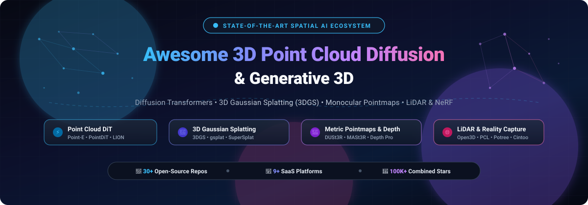

  

# Awesome 3D Point Cloud Diffusion & Generative 3D 

> A curated directory of state-of-the-art **3D Point Cloud Diffusion Models**, **Generative 3D AI**, **3D Gaussian Splatting (3DGS)**, **Monocular Depth & Geometry Transformers**, and **LiDAR / Photogrammetry Reality Capture Systems**.

     

---

## 📌 Executive Summary & Key Highlights 🚀

This repository tracks high-impact **commercial SaaS platforms** and **open-source GitHub repositories** powering modern spatial computing and generative 3D vision:
* 🧠 **Diffusion Transformers & Flow Matching for 3D Geometry**: Synthesize dense 3D point clouds, signed distance fields (SDF), and textured meshes from text prompts or single reference images (`Point-E`, `TRELLIS`, `LION`, `Hunyuan3D 2.0`, `pointdit`).
* 📐 **Monocular Geometry & Metric Depth Foundation Models**: Reconstruct calibrated pointmaps and dense 3D surfaces without camera priors or COLMAP triangulation (`DUSt3R`, `MASt3R`, `Apple Depth Pro`).
* 🔮 **Real-Time Radiance Fields & 3D Gaussian Splatting (3DGS)**: High-speed rasterization, cloud capture, and browser editing of 3D and 4D volumetric scenes (`Scaniverse`, `Luma AI`, `Nerfstudio`, `SuperSplat`, `gsplat`, `Postshot`).
* 🛰️ **Industrial Reality Capture & Point Cloud Processing**: Automated semantic segmentation, alignment, and WebGL streaming of multi-billion-point airborne/terrestrial LiDAR scans (`Open3D`, `CloudCompare`, `PCL`, `PDAL`, `Potree`, `Cintoo Cloud`).

---

## 📑 Table of Contents 🧭

- [📊 Sector Overview & Market Dynamics](#-sector-overview--market-dynamics)
- [☁️ SaaS & Hosted Spatial AI Platforms](#️-saas--hosted-spatial-ai-platforms)
- [💻 Open-Source GitHub Projects (Ranked by Stars)](#-open-source-github-projects-ranked-by-stars)
- [🛠️ Recommended Architectural Pipelines](#️-recommended-architectural-pipelines)
- [⭐ Star History](#-star-history)
- [💖 Support & Sponsorship](#-support--sponsorship)
- [🤝 How to Contribute](#-how-to-contribute)
- [⚖️ Disclaimer & License Guidance](#️-disclaimer--license-guidance)

---

## 📊 Sector Overview & Market Dynamics 📈

The global market for Generative AI in 3D content creation and spatial reality capture is estimated at **$2.5 billion to $3.2 billion**, accelerating at a CAGR exceeding 35% toward **$9.4+ billion** by the early 2030s. 

Rather than a winner-take-all consolidation, the sector is **highly fragmented**:
- 🎯 **Diverse Accuracy Constraints**: Robotics and autonomous driving mandate millimeter-level metric ground truth from LiDAR and SLAM, whereas VFX and gaming prioritize perceptual realism, speed, and clean quad retopology.
- 🔀 **Workflow Dispersion**: Toolchains remain split across capture apps, diffusion backbones, 3D Gaussian editors, and traditional DCC engines (Blender, Unreal Engine, Maya).
- 🔓 **Open-Weights vs. Proprietary APIs**: Rapid advances in open research models (`TRELLIS`, `Hunyuan3D-2`, `DUSt3R`, `Point-E`) create strong local competition against proprietary cloud ecosystems.

---

## ☁️ SaaS & Hosted Spatial AI Platforms 🌐

The table below benchmarks key SaaS reality-capture and generative 3D platforms, sorted descending by company size (valuation / capital raised / ARR):

| Platform | Valuation / Revenue | Starting Pricing | Free Tier Limits | Key Capabilities |
| :--- | :--- | :--- | :--- | :--- |
| **[Niantic Scaniverse](https://scaniverse.com)** | $9.0B Valuation / ~$800M Revenue (Parent Niantic) | $20/month (Plus plan) | Free forever on mobile; unlimited on-device 3D Gaussian Splatting & point-cloud capture/export, 20,000 monthly cloud credits | On-device 3D Gaussian Splatting, LiDAR capture, WebGL sharing, and geospatial mesh processing |
| **[Luma AI](https://lumalabs.ai)** | $4.0B Valuation / ~$75M ARR | $30/month (Plus tier, 10,000 credits/mo) | Free forever; ~80 daily generation credits for low-volume video & 3DGS testing | Cloud 3D Gaussian Splatting, Dream Machine generative video, and text/image-to-3D asset synthesis |
| **[Polycam](https://poly.cam)** | $200M Valuation / ~$6.5M ARR | $30/month ($360/year Pro tier) | Free forever; unlimited LiDAR/room scanning with basic GLTF export (point cloud & CAD export restricted) | Smartphone LiDAR scanning, photogrammetry, 3DGS, and instant browser floor plan generation |
| **[Cintoo Cloud](https://cintoo.com)** | $150M Valuation / ~$19.7M ARR | $1,800/year (bundles of 500 scans) | 30-day free trial; maximum 20 scan uploads and unlimited 3D/BIM model imports | Reality capture SaaS streaming massive LiDAR point clouds as high-fidelity TurboMesh™ with CAD/BIM alignment |
| **[Spline (3DGS & AI)](https://spline.design)** | $80M Valuation / ~$5.5M ARR | $9/editor/month ($12/mo billed monthly) | Free forever; unlimited personal 3D files and viewers (exports include Spline watermark) | Browser-based 3D design studio supporting imported 3D Gaussian Splats, AI 3D gen, and WebGL embeds |
| **[Artec Cloud](https://artec3d.com)** | €15M EIB Venture Debt / ~$27.8M Revenue | $700/year (~$59/mo, 200 GB tier) | Free forever; 5 GB free cloud storage for scan uploads, 3D viewing, and team commenting | Cloud photogrammetry and industrial LiDAR scan processing, point-cloud alignment, and mesh reconstruction |
| **[Pointly](https://pointly.ai)** | Private (Supper & Supper GmbH) | €99/month (Professional S tier, 500 MPoints) | Free forever; 15 million points (15 MPoints) upload limit with pre-trained AI classifiers | Cloud 3D point cloud classification, aerial LiDAR segmentation, and automated feature extraction |
| **[Jawset Postshot](https://jawset.com)** | Private / Bootstrapped | €17/month (~$18.50/mo Indie tier, billed annually) | Free forever; unlimited images & model size (non-commercial only, watermarked, locked exports) | Desktop NeRF & 3D Gaussian Splatting workstation with live previews and Unreal Engine / After Effects plugins |
| **[Gracia AI](https://gracia.ai)** | $2.9M Seed Funding / Pre-ARR | ~$800/minute of processed 4DGS content | Free forever for VR Viewer on Steam, Meta Quest, and Apple Vision Pro (pilot trials for creators) | 6DoF volumetric 4D Gaussian Splatting streaming pipeline for photorealistic VR and spatial computing |

---

## 💻 Open-Source GitHub Projects (Ranked by Stars) ⭐

A comprehensive directory of open-source frameworks, diffusion models, and reality-capture libraries—strictly sorted in descending order by GitHub stargazer count.

- **[3D Gaussian Splatting (`graphdeco-inria/gaussian-splatting`)](https://github.com/graphdeco-inria/gaussian-splatting)**   
  Foundational SIGGRAPH 2023 3D Gaussian Splatting project for real-time radiance field rendering, rasterization, and rapid novel view synthesis.

- **[Tencent Hunyuan3D 2.0 (`Tencent-Hunyuan/Hunyuan3D-2`)](https://github.com/Tencent-Hunyuan/Hunyuan3D-2)**   
  Advanced high-resolution 3D asset generation system synthesizing production-grade textured meshes and geometric shapes from single images or text prompts.

- **[TRELLIS (`microsoft/TRELLIS`)](https://github.com/microsoft/TRELLIS)**   
  Microsoft open-source structured latent diffusion model for fast, high-quality 3D asset generation across Radiance Fields, 3D Gaussians, and meshes.

- **[Open3D (`isl-org/Open3D`)](https://github.com/isl-org/Open3D)**   
  Modern open-source (MIT) C++ and Python library for 3D point cloud processing, ICP alignment, Poisson surface reconstruction, and hardware-accelerated visualization.

- **[Nerfstudio (`nerfstudio-project/nerfstudio`)](https://github.com/nerfstudio-project/nerfstudio)**   
  Modular open-source (Apache-2.0) PyTorch framework unifying 3D Gaussian Splatting (splatfacto), NeRFs, camera pose estimation, and real-time web viewers.

- **[Rerun (`rerun-io/rerun`)](https://github.com/rerun-io/rerun)**   
  High-performance visual data SDK for streaming, logging, and interactively visualizing multimodal 3D point clouds, spatial sensor streams, and computer vision data.

- **[Point Cloud Library (`PointCloudLibrary/pcl`)](https://github.com/PointCloudLibrary/pcl)**   
  Comprehensive, standalone, large-scale open-source C++ framework for 2D/3D point cloud and image processing, KD-tree indexing, and feature estimation.

- **[SuperSplat (`playcanvas/supersplat`)](https://github.com/playcanvas/supersplat)**   
  Free and open-source (MIT) WebGL/WebGPU 3D Gaussian Splatting editor for inspecting, cropping, filtering floaters, and optimizing .ply and .sog splat scenes.

- **[Stable-Dreamfusion (`ashawkey/stable-dreamfusion`)](https://github.com/ashawkey/stable-dreamfusion)**   
  PyTorch implementation of text-to-3D and image-to-3D generation using 2D diffusion models (Stable Diffusion) via Score Distillation Sampling (SDS).

- **[DUSt3R (`naver/dust3r`)](https://github.com/naver/dust3r)**   
  Geometric 3D vision transformer that predicts dense 3D pointmaps directly from uncalibrated image pairs without requiring prior camera parameters or COLMAP.

- **[Threestudio (`threestudio-project/threestudio`)](https://github.com/threestudio-project/threestudio)**   
  Unified modular PyTorch framework for 3D content creation from text, images, and point clouds using diverse diffusion priors and implicit representations.

- **[OpenAI Point-E (`openai/point-e`)](https://github.com/openai/point-e)**   
  Official open-source (MIT) two-stage diffusion pipeline from OpenAI synthesizing synthetic views and generating colored 3D point clouds and SDF meshes.

- **[gsplat (`nerfstudio-project/gsplat`)](https://github.com/nerfstudio-project/gsplat)**   
  CUDA-accelerated Python library for 3D Gaussian Splatting rasterization, memory-efficient backpropagation, and lightning-fast differentiable rendering.

- **[Apple Depth Pro (`apple/ml-depth-pro`)](https://github.com/apple/ml-depth-pro)**   
  Foundation model for zero-shot metric monocular depth estimation producing sharp, high-frequency dense 3D point clouds and focal length predictions in sub-second time.

- **[Potree (`potree/potree`)](https://github.com/potree/potree)**   
  Free open-source (BSD-2-Clause) WebGL point cloud renderer engineered to stream and visualize multi-billion-point LiDAR and photogrammetry datasets directly in browsers.

- **[PointNet (`charlesq34/pointnet`)](https://github.com/charlesq34/pointnet)**   
  Pioneering deep learning architecture directly consuming raw unstructured 3D point clouds for 3D object classification, part segmentation, and scene parsing.

- **[Brush (`ArthurBrussee/brush`)](https://github.com/ArthurBrussee/brush)**   
  Modern, high-performance universal 3D Gaussian Splatting viewer and reconstruction system written in Rust and WebGPU.

- **[CloudCompare (`CloudCompare/CloudCompare`)](https://github.com/CloudCompare/CloudCompare)**   
  Industry-standard open-source (GPL-2.0+) 3D point cloud and triangular mesh processing suite for massive LiDAR registration, segmentation, and distance analysis.

- **[MASt3R (`naver/mast3r`)](https://github.com/naver/mast3r)**   
  Matching and Stereo 3D Reconstruction pipeline extending DUSt3R with fast local feature matching and dense metric point cloud generation.

- **[PDAL (`PDAL/PDAL`)](https://github.com/PDAL/PDAL)**   
  Point Data Abstraction Library providing composable pipelines for translating, filtering, and processing geospatial LiDAR point clouds in LAS, LAZ, and E57 formats.

- **[PointNeXt (`guochengqian/PointNeXt`)](https://github.com/guochengqian/PointNeXt)**   
  Next-generation modernized PointNet++ baseline utilizing modern training techniques and inverted residual architectures for fast point cloud representation learning.

- **[LION (`nv-tlabs/LION`)](https://github.com/nv-tlabs/LION)**   
  NVIDIA NeurIPS Hierarchical Latent Point Diffusion model combining Point-Voxel VAEs with dual latent diffusion models for high-resolution 3D shape generation.

- **[Diffusion Point Cloud (`luost26/diffusion-point-cloud`)](https://github.com/luost26/diffusion-point-cloud)**   
  Foundational CVPR 2021 probabilistic diffusion model for 3D point cloud generation, auto-encoding, point completion, and unsupervised shape upsampling.

- **[GaussianAnything (`NIRVANALAN/GaussianAnything`)](https://github.com/NIRVANALAN/GaussianAnything)**   
  ICLR 2025 cascaded 3D native diffusion pipeline utilizing a point-cloud structured latent space to generate editable 3D Gaussian assets from text or images.

- **[PVD (`alexzhou907/PVD`)](https://github.com/alexzhou907/PVD)**   
  ICCV 2021 Point-Voxel Diffusion framework unifying point-level and voxel-level representations for 3D shape synthesis and dense point-cloud completion.

- **[google-research/pointdit (`google-research/pointdit`)](https://github.com/google-research/pointdit)**   
  ICML 2026 open-source minimalist pixel-space Diffusion Transformer (ViT) conditioned on frozen DINOv3 tokens that directly denoises raw 3D point map patches.

- **[Occupancy Flow (`autonomousvision/occupancy_flow`)](https://github.com/autonomousvision/occupancy_flow)**   
  4D reconstruction architecture learning continuous vector fields in space and time to capture dense motion and continuous generative shape representations.

- **[SLIDE (`SLIDE-3D/SLIDE`)](https://github.com/SLIDE-3D/SLIDE)**   
  Sparse Latent Point Diffusion model encoding 3D geometries into sparse latent points with rich features for controllable point-cloud and mesh generation.

- **[SPVD (`JohnRomanelis/SPVD`)](https://github.com/JohnRomanelis/SPVD)**   
  TNNLS 2025 Sparse Point-Voxel Diffusion framework leveraging TorchSparse for scalable conditional point cloud generation, completion, and super-resolution.

- **[DiffFacto (`diffFacto/diffFacto`)](https://github.com/diffFacto/diffFacto)**   
  ICCV 2023 controllable part-based 3D point cloud generation model using cross-diffusion to factor independent part geometries and spatial configurations.

- **[Awesome-Point-Cloud-Generation (`Dekai21/Awesome-Point-Cloud-Generation`)](https://github.com/Dekai21/Awesome-Point-Cloud-Generation)**   
  Curated chronological index of point-cloud diffusion, flow-matching, and autoregressive architectures (DiT-3D, TIGER, PSF, SeaLion).

---

## 🛠️ Recommended Architectural Pipelines 🧩

For teams building end-to-end custom 3D point cloud diffusion and generative 3D pipelines:

1. 📷 **Geometry Ingestion & Dense Point Extraction**: Use **Apple Depth Pro** or **DUSt3R / MASt3R** for instant, calibration-free 3D pointmap estimation from unposed camera views.
2. 🪄 **Generative Denoising & Shape Synthesis**: Employ **google-research/pointdit**, **microsoft/TRELLIS**, or **OpenAI Point-E** for dense point diffusion, flow matching, and structured latent completion.
3. ⚡ **Radiance Field Representation**: Train real-time 3D Gaussian Splats via **Nerfstudio (`gsplat`)** or **Brush**.
4. 🧹 **Processing, Cleansing & Production Polish**: Leverage **Open3D** for surface reconstruction / outlier filtering and **SuperSplat** for browser-based interactive crop and float removal.
5. 📊 **Streaming & Big-Data Visualization**: Deploy **Potree** or **Rerun** for multi-gigabyte browser/client streaming of point clouds and camera telemetry.

---

## ⭐ Star History

---

## 💖 Support & Sponsorship ☕

If you found this curated ecosystem index helpful for your research, projects, or organization, please consider supporting the project:

- ⭐ **Star this repository** on GitHub to help others discover it!
- 🍴 **Fork and contribute** new tools, datasets, or research papers.
- 📢 **Share with your colleagues** in 3D computer vision, graphics, and spatial AI.
- ☕ **Buy me a coffee / Sponsor on GitHub**: Support ongoing curation and maintenance via the [GitHub Sponsor Dashboard](https://github.com/sponsors/ishandutta2007).

---

## 🤝 How to Contribute 🚀

Contributions from researchers, engineers, and creators are warmly welcomed!

1. 🍴 Fork this repository.
2. 🌿 Create a feature branch (`git checkout -b feature/new-3d-tool`).
3. 📝 Add or update entries under `README.md` following the established table / badge conventions.
4. ✅ Ensure factual pricing, verified GitHub links, and proper category placement.
5. 🚀 Open a Pull Request with a brief summary of the project.

---

## ⚖️ Disclaimer & License Guidance 📜

* ℹ️ This compilation is a **community-curated index** provided for educational and research purposes.
* 🖥️ Point cloud diffusion transformers and foundational models (`PointDiT`, `TRELLIS`, `DUSt3R`, `DINOv3`) may require high-memory GPUs (CUDA 12+) and specific research license agreements for model weights.
* 📄 Review each project's individual open-source license (`MIT`, `Apache-2.0`, `BSD-2-Clause`, `GPL-2.0+`, or custom academic non-commercial terms) prior to production deployment.
